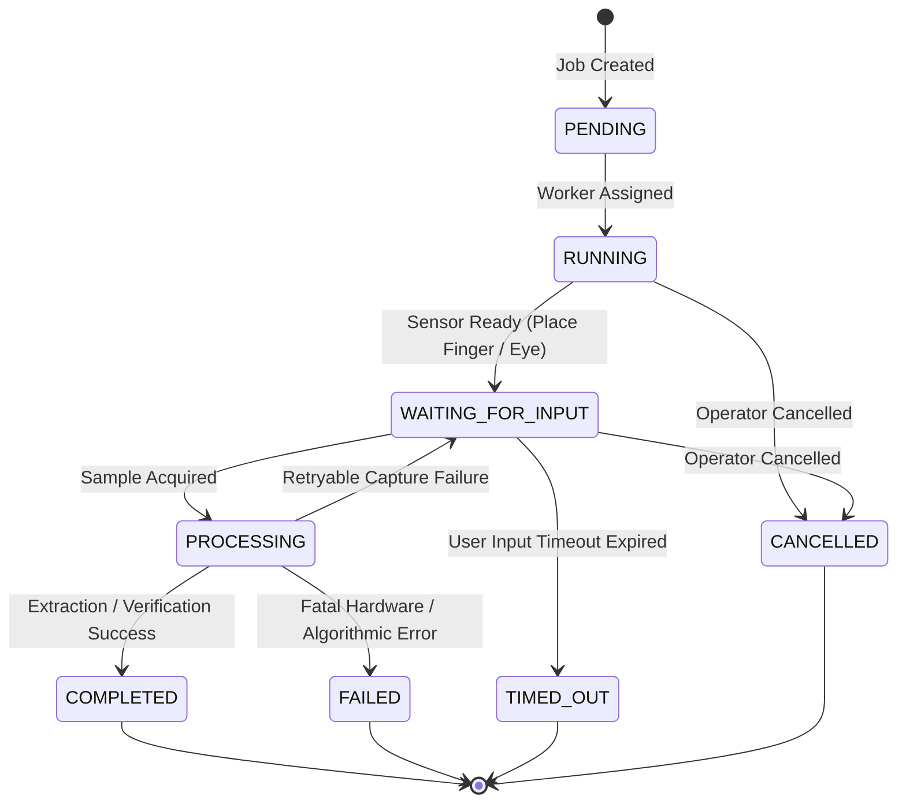
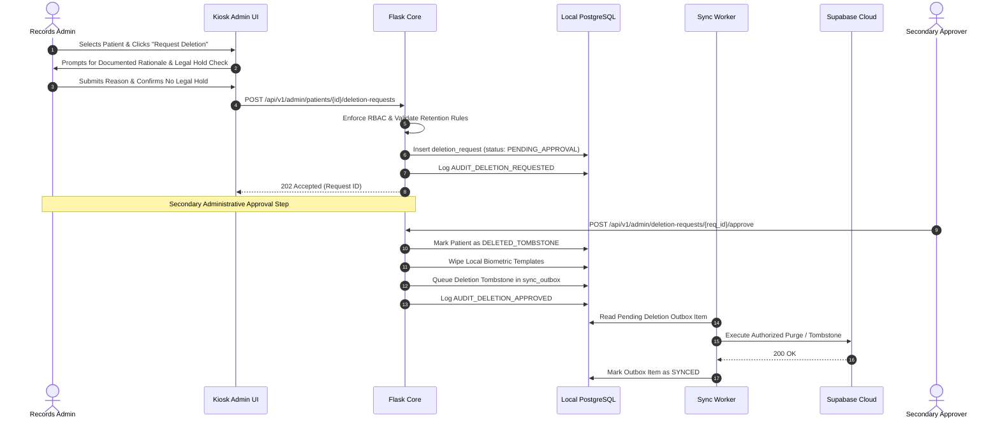

# LifeLink 2.0 — Technical Architecture Design

**Document:** `docs/architecture.md`  
**Author:** Lead Development Engineer, LifeLink 2.0  
**Date:** 2026-10-13  
**Status:** Approved System Architecture  

---

## 1. System Overview

LifeLink 2.0 is an emergency medical identity and patient record management system designed for a Raspberry Pi 5 touchscreen kiosk terminal. The system features:
1. **Fully Wired Peripheral Topology:** Zero dependency on Wi-Fi or Bluetooth for hardware communication.
2. **Offline-First Local Operations:** Patient registration, retrieval, updating, and administrative functions operate independently of internet availability using a local PostgreSQL store.
3. **Hybrid Cloud Synchronization:** Transactional outbox syncs approved clinical records and audit logs to Supabase Cloud when wired hospital Ethernet/internet is available. Biometric templates remain encrypted locally and are never synced to the cloud by default.
4. **Role-Based Workstations:** Clinical Login, Hospital Login, and Admin Login portals backed by individual staff identities and server-enforced RBAC.
5. **Admin Patient Management:** Complete administrative control over patient records (view, edit, archive, and audited multi-stage deletion requests).

---

## 2. Hardware Topology

```text
 ┌──────────────────────────────────────────────┐
 │ GT-521F32 Optical Fingerprint Sensor        │
 └──────────────────────┬───────────────────────┘
                        │ UART (TX:GPIO16, RX:GPIO17, 3V3, GND)
                        ▼
 ┌──────────────────────────────────────────────┐
 │ ESP32 Microcontroller (Firmware Daemon)     │
 └──────────────────────┬───────────────────────┘
                        │ USB Data Cable (CDC / Serial 115200)
                        ▼
 ┌──────────────────────────────────────────────┐
 │ RASPBERRY PI 5 TOUCHSCREEN TERMINAL          │
 │                                              │
 │  ┌────────────────────────────────────────┐  │
 │  │ Chromium Touchscreen Kiosk UI          │  │
 │  └────────────────────┬───────────────────┘  │
 │                       │ HTTP / WebSocket     │
 │                       ▼                      │
 │  ┌────────────────────────────────────────┐  │
 │  │ Core Backend Service (Flask)           │  │
 │  │  - Auth & RBAC Middleware              │  │
 │  │  - Patient Workflows Engine            │  │
 │  │  - Admin Management Service            │  │
 │  │  - Device Job Orchestrator             │  │
 │  └───────┬────────────────────┬───────────┘  │
 │          │                    │              │
 │          ▼                    ▼              │
 │  ┌───────────────┐    ┌──────────────────┐   │
 │  │ Local DB      │    │ Iris Inference   │   │
 │  │ (PostgreSQL)  │    │ Engine (PyTorch) │   │
 │  │ - Caches      │    │ - LightIrisNet   │   │
 │  │ - Encrypted   │    │ - Daugman Norm   │   │
 │  │   Templates   │    │ - Vis-IrisFormer │   │
 │  │ - Outbox      │    └──────────────────┘   │
 │  └───────┬───────┘                           │
 └──────────┼───────────────────▲───────────────┘
            │                   │
            │                   │ USB Gadget Ethernet (192.168.55.0/24)
            │                   │ HTTP Camera API (Port 5001)
            │                   │
            │            ┌──────┴─────────────────────────┐
            │            │ Raspberry Pi Zero W            │
            │            │  - Picamera2 Capture Daemon    │
            │            │  - ISO/IEC Quality Filter      │
            │            └──────────────▲─────────────────┘
            │                           │ CSI Ribbon
            │            ┌──────────────┴─────────────────┐
            │            │ Camera Module 3 Wide NoIR      │
            │            └────────────────────────────────┘
            │
            ▼ Wired Hospital Ethernet / HTTPS
 ┌──────────────────────────────────────────────┐
 │ Supabase Cloud                               │
 │  - Central Clinical Database                 │
 │  - Row Level Security (RLS)                  │
 │  - Central Audit Log                         │
 └──────────────────────────────────────────────┘
```

---

## 3. Monorepo Directory Layout

```text
LifeLink_2.0/
├── AGENTS.md                   # Persistent workspace rules & invariants
├── README.md                   # Quickstart, setup, run commands
├── .env.example                # Sample environment configuration
├── docs/                       # Specifications, audits, protocols, runbooks
├── frontend/                   # Touchscreen Kiosk UI
│   ├── css/                    # Clinical dark/light theme stylesheets
│   ├── js/                     # Component controllers & API client
│   └── templates/              # HTML kiosk screens & dialogs
├── backend/                    # Python Flask Core Application
│   ├── app.py                  # App factory & server bootstrap
│   ├── config.py               # Settings & mode flags (MOCK_MODE, etc.)
│   ├── auth/                   # Staff auth, Argon2id hashing, RBAC
│   ├── patients/               # Registration, retrieval, updates
│   ├── admin/                  # Admin endpoints (patients, staff, audit, sync)
│   ├── biometrics/             # Fusion, candidate search, 1:1 verify
│   ├── devices/                # Device job state machine & host workers
│   │   ├── mock/               # Mock device simulators
│   │   ├── fingerprint_host.py # Pi 5 USB serial worker
│   │   └── camera_host.py      # Pi 5 USB Ethernet camera worker
│   ├── audit/                  # Tamper-evident audit service
│   └── database/               # Database connection & encryption layer
├── fingerprint-device/
│   ├── esp32/                  # MicroPython firmware for ESP32
│   │   ├── main.py             # USB framed protocol daemon
│   │   └── fplibMicro.py       # GT-521F32 UART driver
│   └── protocol/               # Binary framing specification & test vectors
├── iris-module/
│   ├── camera-client/          # Pi Zero W Picamera2 capture daemon
│   │   ├── camera_service.py   # HTTP service on USB gadget link
│   │   └── quality.py          # ISO/IEC quality evaluation in RAM
│   └── engine/                 # Pi 5 ML inference service
│       ├── segmenter.py        # LightIrisNet wrapper (MobileNetV3)
│       ├── normalizer.py       # Daugman rubber-sheet unwrapping
│       └── recognizer.py       # Vis-IrisFormer wrapper (MAE+RoPE2D)
├── database/
│   ├── local/migrations/       # PostgreSQL migrations for Pi 5
│   └── supabase/migrations/    # Supabase cloud migrations & RLS
├── sync/                       # Transactional outbox sync worker
│   └── worker.py               # Reconciles local outbox with Supabase
├── deploy/                     # systemd service units & udev rules
├── scripts/                    # CLI utilities: bootstrap, seed, mock, test
└── tests/                      # Pytest suite: unit, integration, contracts, E2E
```

---

## 4. Device Job State Machine

To prevent concurrency collisions and serial port contention, all biometric hardware operations are coordinated via asynchronous jobs managed by `DeviceJobManager`:



---

## 5. Persistence Architecture

### 5.1 Local PostgreSQL Store (Pi 5)
- **`patients_cache`:** Local copy of registered patients, UUID, human LifeLink ID, status (`active`, `archived`, `deletion_pending`).
- **`fingerprint_templates`:** 10 finger slots (`R1`–`R5`, `L1`–`L5`). Templates are 498 bytes each, stored encrypted using AES-256-GCM via `cryptography` / pgcrypto.
- **`iris_templates`:** OD and OS iris slots. Stored as encrypted binary embeddings ($128 \times 768$ float32), accompanied by model ID, tensor version, and quality metrics.
- **`clinical_cache`:** Cached allergies, conditions, medications, and emergency contacts for offline emergency retrieval.
- **`staff_accounts`:** Local staff identities, hashed passwords (Argon2id), roles, and offline verifiers.
- **`device_jobs`:** Transient and historical hardware job records.
- **`record_revisions`:** Version history for all edited patient fields with author ID and documented rationale.
- **`audit_events`:** Tamper-evident log of all clinical views, modifications, authentications, and deletions.
- **`sync_outbox`:** Durable transactional queue storing JSON payloads, operation IDs, retry counts, and status (`pending`, `synced`, `conflict`, `failed`).

### 5.2 Supabase Cloud Store
- Central repository for clinical and demographic records: `patients`, `emergency_contacts`, `allergies`, `medical_conditions`, `medications`, `surgeries`, `medical_devices`, `clinical_records`, `staff_profiles`, `audit_events`, `deletion_requests`.
- Strict Row Level Security (RLS) policies enforce authorized service-role access from verified Pi 5 terminals.
- **Zero Cloud Biometrics:** Biometric templates and raw eye crops are strictly excluded from cloud synchronization.

---

## 6. Security Architecture & RBAC

### 6.1 Role Definitions
1. **Clinician (`clinician`):** Full read access to emergency and clinical records; permitted to update medical notes, allergies, and diagnoses with mandatory provenance.
2. **Registration Staff (`registration_staff`):** Permitted to enroll new patients and edit demographic/contact details; restricted from clinical notes.
3. **Records Administrator (`records_admin`):** Permitted to manage patient lifecycles, archive records, initiate audited deletion requests, and review access logs.
4. **System Administrator (`system_admin`):** Manages staff accounts, hardware device diagnostics, backup health, and sync configurations. Restricted from patient medical records.

### 6.2 Deletion Request Workflow


